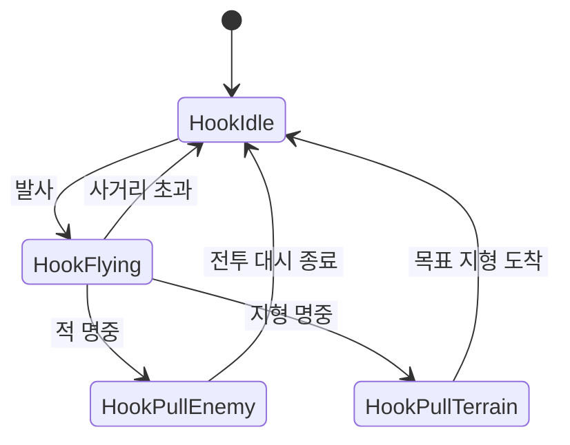

# 대상별 상태 전환을 사용하는 후크 액션

**담당자:** 최성원 — 개인 프로젝트 전체 구현, Codex를 구현·개선 보조 도구로 활용

## 코드



**Hook / HookMode:** 후크의 발사·이동 상태를 보관합니다. **UpdateHookFlight:** 적·지형 충돌을 판정합니다. **AttachHookToCombatTarget:** 전투 이동 목표를 정합니다. **UpdateHookPull:** 목표까지 대시를 진행합니다.

**enum 기반 FSM**으로 상태와 전환 조건을 모았습니다. 상태별 클래스에 동작을 위임하는 GoF State 패턴과는 구분하며, 위 도식은 대표 이동·전투 분기만 보여줍니다.

```cpp
enum HookMode
{
    HookIdle, HookFlying, HookPullTerrain,
    HookPullEnemy, HookSuperOrb, HookShopPortal
};

// Hook에서 이 발췌에 필요한 필드만 표시
struct Hook
{
    HookMode mode;
    Vec2 position, direction, target, dashStart;
    float distance, pauseTimer, dashTimer, dashDuration;
    bool vault, dashing;
};

// 비행 이동 → 대상 충돌 → 범위 초과 시 실패 처리
static void UpdateHookFlight(float dt)
{
    float step = 520.0f * dt;
    gHook.position.x += gHook.direction.x * step;
    gHook.position.y += gHook.direction.y * step;
    gHook.distance += step;

    for (auto& enemy : gEnemies)
    {
        if (enemy.alive && PointInRect(gHook.position, enemy.bounds))
        {
            // 명중한 대상이 상태와 목표를 결정하며 이 틱의 추가 충돌 탐색은 끝낸다.
            AttachHookToEnemy(enemy);
            return;
        }
    }

    for (const auto& platform : gPlatforms)
    {
        if (platform.active && platform.category == PlatformSolid
            && PointInRect(gHook.position, platform.bounds))
        {
            AttachHookToPlatform(platform);
            return;
        }
    }

    if (gHook.distance >= 190.0f
        || gHook.position.x < 0 || gHook.position.x >= kBufferW
        || gHook.position.y < 0 || gHook.position.y >= kBufferH)
    {
        gHook.mode = HookIdle;
        TriggerHookMissCooldown();
    }
}
```

```cpp
// 적·전투 오브젝트에 걸리면 입력에 따라 도착 위치를 결정
static void AttachHookToCombatTarget(Vec2 center)
{
    gHook.mode = HookPullEnemy;
    gHook.position = center;
    gHook.pauseTimer = 0.0f;
    gHook.dashing = false;
    gHitStopTimer = 0.11f;
    // 점프 입력을 함께 누르면 적을 통과하는 대신 위쪽 위치를 목표로 삼는다.
    gHook.vault = gInput.keys[VK_SPACE] || gInput.keys['W']
        || gInput.keys[VK_UP];
    if (gHook.vault)
        gHook.target = { center.x, center.y - 25.0f };
    else
        gHook.target = { center.x + gHook.direction.x * 30.0f,
                        center.y + gHook.direction.y * 30.0f };
}

// BeginDash: 경로가 중앙 분리벽을 가로지르면 이동 취소
static void BeginDash()
{
    if (SegmentHitsBranchDivider(gPlayer.position, gHook.target))
    {
        gHook.mode = HookIdle;
        gHook.dashing = false;
        ResolveBranchDividerOverlap();
        return;
    }

    gHook.dashing = true;
    gHook.dashTimer = 0.0f;
    gHook.dashDuration = 0.045f;
    // 시작 위치를 고정해 각 틱의 현재 위치가 아닌 동일한 두 끝점 사이를 보간한다.
    gHook.dashStart = gPlayer.position;
    KillEnemiesInSlash(gHook.dashStart, gHook.target);
}

// UpdateHookPull의 전투 대시 부분: 지형·포탈·오브 분기는 생략
static void UpdateCombatPull(float dt)
{
    gPlayer.velocity = { 0.0f, 0.0f };
    if (!gHook.dashing)
    {
        gHook.pauseTimer -= dt;
        if (gHook.pauseTimer <= 0.0f) BeginDash();
        return;
    }

    gHook.dashTimer += dt;
    // 시간이 목표를 지나도 t를 1로 제한해 도착점을 초과하지 않게 한다.
    float t = Clamp(gHook.dashTimer / gHook.dashDuration, 0.0f, 1.0f);
    gPlayer.position = {
        gHook.dashStart.x + (gHook.target.x - gHook.dashStart.x) * t,
        gHook.dashStart.y + (gHook.target.y - gHook.dashStart.y) * t
    };
    if (t >= 1.0f) FinishDash();
}
```

## 생략 및 재구성한 내용

- 원본: `1Seong/hell-pit`의 `src/main.cpp` (HookMode, Hook, UpdateHookFlight, AttachHookToCombatTarget, BeginDash, UpdateHookPull). 기준 커밋: `fdc7490a6dd0e2962980e1ea2a88db999846affe`.
- 적·지형 판정과 전투 대시를 대표로 남겼습니다. 생략된 분기가 있으므로 샘플이 전체 충돌 우선순위를 재현하지는 않습니다.
- UpdateHookPull의 전투 분기를 설명용 UpdateCombatPull로 분리했습니다. 
- 발사 입력·정규화, 적 처치 함수, 지형 도착 위치 보정, 대시 종료 처리와 잔상·효과음·화면 흔들림은 생략했습니다. 
- 배열·Vec2·입력·타이머·충돌 및 벡터 함수는 원본 전역 의존성으로 단독 실행되지 않습니다. 단일 파일에서 발췌한 설명용 코드입니다.
